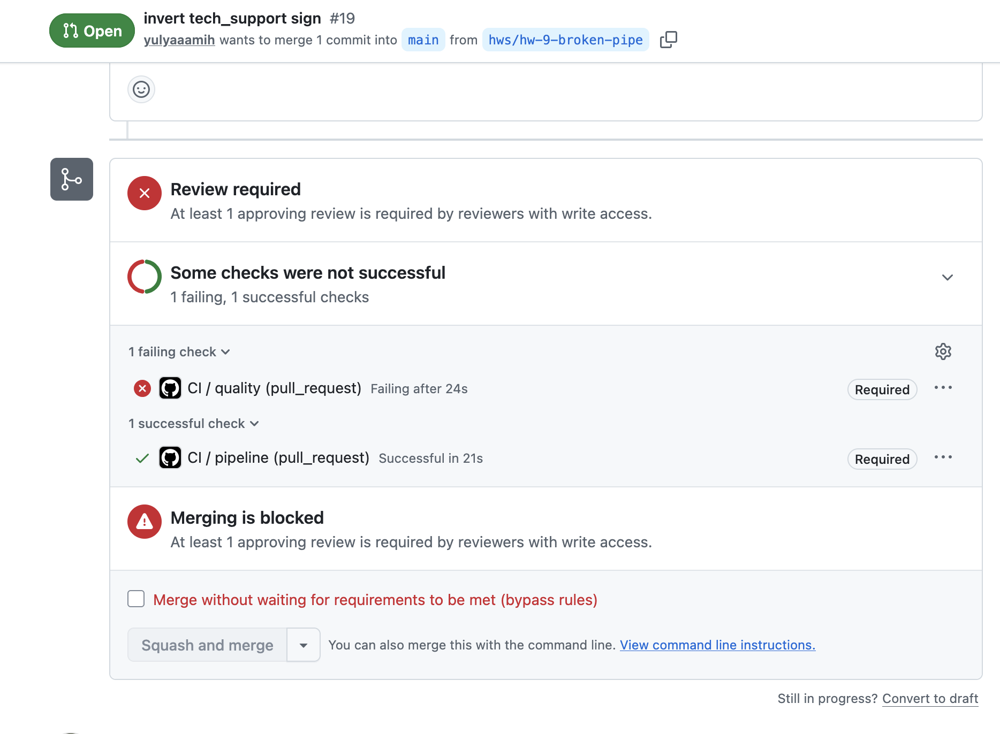
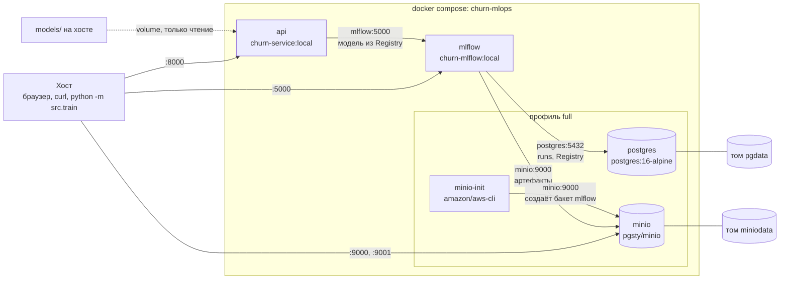

# Churn MLOps


Сквозной проект курса MLOps: предсказание оттока клиентов телеком-оператора
(бинарная классификация, табличные данные). К концу семестра из него вырастет
ML-сервис с пайплайном, тестами, CI/CD и мониторингом.

## Как запустить

```bash
python -m venv .venv
source .venv/bin/activate          # Windows: .venv\Scripts\Activate.ps1
make install                       # зависимости
make check                         # должно напечатать environment: OK
make data                          # сгенерировать data/raw/churn.csv
make prepare                       # train/val/test в data/processed/
make train                         # обучить модель, метрики на val
```

Остальные команды: `make test` (тесты), `make lint` (ruff). Список всех целей — `make help`.

Результаты обучения:
- `models/model.joblib` — весь Pipeline (препроцессор + модель), в Git не хранится;
- `reports/train_metrics.json` — ROC-AUC, PR-AUC и F1 на val.

## Как это устроено

| Стадия | Файл | Что делает |
|---|---|---|
| данные | `src/data/generate.py` | генерирует синтетический датасет с фиксированным seed |
| prepare | `src/data/prepare.py` | проверяет колонки, заполняет пропуски в `total_charges` (`monthly_charges * tenure_months`), делит на train/val/test (70/10/20) со stratify по `churn` |
| признаки | `src/features.py` | `ColumnTransformer`: числовые (медиана + масштабирование), категориальные (самая частая + one-hot), бинарные без изменений |
| train | `src/train.py` | Pipeline из препроцессора и модели; модель выбирается в `params.yaml`, метрики считаются на val |

Все настройки лежат в `params.yaml`: seed, размеры выборок, списки признаков,
модель и её гиперпараметры. Чтобы сменить модель, достаточно поменять
`train.model` на `logreg`, `random_forest` или `gradient_boosting` — код при
этом не меняется.

## Данные

Датасет `data/raw/churn.csv` и модель `models/model.joblib` версионируются
через [DVC](https://dvc.org). В Git лежат только маленькие файлы-указатели
`data/raw/churn.csv.dvc` и `models/model.joblib.dvc` с md5 содержимого. Сами
файлы хранятся в remote-хранилище. Описание датасета, полей и известных
дефектов — в [data/README.md](data/README.md).

### Где лежит remote

Remote по умолчанию называется `minio`. Это S3-совместимое хранилище
[MinIO](https://min.io):

| Параметр | Значение |
|---|---|
| бакет и путь | `s3://mlops/churn` |
| адрес (endpoint) | `http://localhost:9000` |
| веб-консоль | `http://localhost:9001` |

Настройки лежат в `.dvc/config`. MinIO запущен в Docker на машине автора
проекта, поэтому `localhost` подходит только ей. Остальным нужно либо
подключиться к её MinIO по адресу в локальной сети, либо поднять свой
(см. ниже).

### Как получить данные

```bash
dvc remote modify --local minio access_key_id <ключ>
dvc remote modify --local minio secret_access_key <секрет>
dvc pull
```

`dvc pull` скачает версии данных и модели, на которые указывают `.dvc`-файлы
в текущем коммите. Ключи можно не прописывать через `dvc remote modify`, а
передать переменными окружения `AWS_ACCESS_KEY_ID` и `AWS_SECRET_ACCESS_KEY`
(их имена есть в `.env.example`).

Флаг `--local` записывает настройки в `.dvc/config.local`. Этот файл не
попадает в Git, поэтому ключи не утекут в репозиторий.

### Новому участнику проекта

1. Склонируйте репозиторий и установите зависимости (раздел «Как запустить»).
   DVC ставится вместе с ними через `make install`.
2. Получите доступ к хранилищу. Есть два варианта:
   - **Подключиться к общему MinIO.** Попросите у автора адрес и ключи и
     пропишите их у себя:
     ```bash
     dvc remote modify --local minio endpointurl http://<адрес>:9000
     dvc remote modify --local minio access_key_id <ключ>
     dvc remote modify --local minio secret_access_key <секрет>
     ```
   - **Поднять свой MinIO.** Пригодится, если общий недоступен:
     ```bash
     docker run -d --name minio -p 9000:9000 -p 9001:9001 \
       -v ~/minio-data:/data quay.io/minio/minio server /data --console-address ":9001"
     ```
     Затем в веб-консоли `http://localhost:9001` создайте бакет `mlops`.
     Своё хранилище будет пустым. Сгенерируйте данные (`make data`), это даст
     тот же файл, что и в DVC: при тех же `seed` и `n_samples` md5 совпадает.
     После этого выполните `dvc push`.
3. Выполните `dvc pull`. Проверьте, что `wc -l data/raw/churn.csv` выдаёт
   `20001`, а `dvc status` пишет, что всё синхронизировано.
4. Дальше работайте как обычно: `make prepare`, `make train`.

**Если вы поменяли данные или модель:**

```bash
dvc add data/raw/churn.csv          # или models/model.joblib
git add data/raw/churn.csv.dvc
git commit -m "..."
dvc push                            # без этого другие не смогут скачать новую версию
```

**Если нужна старая версия данных:** переключитесь на нужный коммит
(`git checkout <коммит>`) и выполните `dvc checkout`. Пример с выводом
терминала — в [reports/ROLLBACK.md](reports/ROLLBACK.md).

### Почему `.dvc`-файл коммитим, а датасет — нет

В `.dvc`-файле записан md5 данных, весит он меньше 100 байт. Он лежит в Git,
поэтому у каждого коммита своя версия данных: `git checkout` + `dvc checkout`
возвращают и код, и данные. Сам CSV хранится в DVC-кэше и в MinIO.

Датасет в Git не кладём: Git хранит каждую версию файла целиком и навсегда,
репозиторий быстро пухнет, а у GitHub лимит 100 МБ на файл.

Если сделать наоборот, DVC перестанет работать. Без `.dvc`-файла в клоне
`dvc pull` не знает, что скачивать, откатить данные нельзя, и уже не понять,
на какой версии данных обучена модель.

## Пайплайн

Стадии описаны в `dvc.yaml`: `generate -> prepare -> validate -> train -> evaluate`.
Запуск — `make pipeline` (это `dvc repro`): DVC перезапускает только те стадии,
у которых поменялись код, данные или параметры.

### Что будет, если убрать `src/features.py` из `deps` стадии `train`

DVC перестанет замечать изменения в препроцессоре. Поменяли, например,
заполнение пропусков или добавили признак в `features.py` — `dvc repro`
скажет, что `train` не изменился, и оставит старую модель. Метрики и
`dvc.lock` тоже останутся старыми, и будет казаться, что изменение ни на
что не повлияло.

Это опаснее падения скрипта, потому что ошибку будет не заметной.

## Трекинг экспериментов

`make train` логирует прогон в MLflow (эксперимент `churn`): параметры,
метрики, ROC-кривую, матрицу ошибок и модель. `--register` добавляет модель
в реестр, `dvc repro` запускает обучение с `--no-mlflow`. `make leaderboard`
собирает топ-5 прогонов в [reports/LEADERBOARD.md](reports/LEADERBOARD.md).

### Зачем `data_md5`, если есть `git_sha`

`git_sha` указывает на коммит, но не гарантирует, что модель обучена на
данных из этого коммита:

- **Данные можно поменять без коммита**, например перегенерировать или
  сделать `dvc pull` другой версии. `git_sha` при этом не изменится.
- **Обучение не всегда происходит на новом коммите.** Все прогоны занятия 6
  записаны с одним `git_sha` (`8aa7b6b`), хотя между ними всё менялось.

`data_md5` считается по самому файлу при обучении и показывает, на каких
данных модель обучена на самом деле.

## Выбор модели

Лучший ROC-AUC на val по каждому алгоритму (12 прогонов, по 4 набора
гиперпараметров на модель):

| Модель | Лучшие параметры | ROC-AUC |
|---|---|---|
| `logreg` | C=0.01 | 0.8093 |
| `gradient_boosting` | n_estimators=100, learning_rate=0.1, max_depth=2 | 0.8078 |
| `random_forest` | n_estimators=157, max_depth=5, min_samples_leaf=3 | 0.8012 |

**Модель:** `logreg`, C=0.1. Модели сравниваются по ROC-AUC: он не зависит
от порога и показывает, насколько хорошо модель ранжирует клиентов.
Логистическая регрессия лучшая и при этом самая простая. C=0.01 даёт ROC-AUC
выше всего на 0.0006, это в пределах шума, поэтому оставлена C=0.1, под
которую подобран порог.

**Порог:** 0.252 вместо 0.5, подобран на val по максимуму F1. Отток всего
~21 %, и при пороге 0.5 модель пропускает больше двух третей уходящих. Упустить
клиента дороже, чем дать лишнюю скидку, поэтому порог снижен. F1 на test
вырос с 0.41 до 0.53.

Подробности — в [reports/EXPERIMENTS.md](reports/EXPERIMENTS.md), топ прогонов
из MLflow — в [reports/LEADERBOARD.md](reports/LEADERBOARD.md).

## Тесты

```bash
make test
```

22 теста, прогон меньше 1 с. Тесты не зависят от запуска пайплайна: данные генерируются в фикстуре.

### Покрытие

```bash
pytest --cov=src --cov-report=term-missing
```

Общее покрытие: **31 %**.

| Модуль | Покрытие |
|---|---|
| `src/features.py` | 100 % |
| `src/logging_setup.py` | 100 % |
| `src/config.py` | 88 % |
| `src/data/generate.py` | 68 % |
| `src/data/prepare.py` | 43 % |
| `src/train.py` | 32 % |
| `src/data/validate.py` | 0 % |
| `src/evaluate.py` | 0 % |
| `src/service/model_loader.py` | 0 % |
| `src/smoke_check.py` | 0 % |

Цель не 100 %. Тесты проверяют логику, от которой зависит качество модели: препроцессинг, обучение, поведение модели.

Покрывать не имеет смысла:

- `main()` и разбор аргументов в `generate.py`, `prepare.py`, `train.py`, `evaluate.py`. Это обвязка для запуска из командной строки, её проверяет `dvc repro`.
- Сохранение артефактов и логирование в MLflow (`train.py`). Требуют файловой системы и сервера MLflow, это интеграция, а не логика.
- `get_git_sha()`: обёртка над вызовом `git`.
- `src/smoke_check.py`: сам является проверкой окружения.
- Ветка `drift=True` в `generate.py`: используется с занятия 15.

Стоит покрыть позже:

- `src/data/validate.py`: ошибка в правилах валидации пропустит плохие данные в обучение.
- `split()` в `prepare.py`: стратификация и детерминированность сплита.
- `src/service/model_loader.py`: будет покрыт тестами API на занятии 10.

## CI

Workflow `.github/workflows/ci.yml` запускается на каждый PR и push в `main`:

- `quality`: `ruff check`, `ruff format --check`, `pytest` с покрытием;
- `pipeline`: пайплайн на 4000 строках, проверка порога `min_roc_auc`, метрики комментарием в PR.

### Кэширование

Кэшируется папка установленного Python (`env.pythonLocation`) вместе с пакетами. Ключ зависит от хеша `requirements.txt` и `requirements-dev.txt`. При попадании в кэш шаг установки зависимостей пропускается.

| Прогон | Total duration |
|---|---|
| без кэша | 2m 7s |
| с кэшем | 41s |

Стандартный `cache: pip` в `setup-python` давал около 1m 10s и заметного ускорения не давал: он сохраняет только скачанные пакеты, а установка выполняется при каждом прогоне.

### Блокировка мержа

В защите `main` обязательный чек `quality`. Проверено на PR с инвертированным знаком `tech_support` в `src/data/generate.py`: упал `test_tech_support_decreases_churn_risk`, мерж заблокирован. PR закрыт без мержа.



### Почему `pytest` в CI, а не только в pre-commit

Команда одна, но гарантии разные:

- **pre-commit можно обойти.** Хук работает, только если выполнен `pre-commit install`, и отключается флагом `git commit --no-verify`. CI запускается на каждый PR независимо от настроек у автора.
- **CI работает в чистом окружении.** Зависимости ставятся из `requirements*.txt`, кода и данных, которых нет в репозитории, там нет. Локально тесты могут пройти за счёт незакоммиченного файла, сгенерированных данных или другой версии библиотеки.
- **Результат CI виден всем и блокирует мерж.** Результат pre-commit видит только автор коммита.
- **pre-commit должен быть быстрым.** Если на каждый коммит обучать модель, хук начнут отключать. В pre-commit остаются линтер и формат, тесты идут в CI.

## Инференс-сервис

```bash
make serve
```

### Контракт API

Сервис возвращает вероятность ухода клиента. Базовый адрес при локальном запуске: `http://localhost:8000`. Все запросы и ответы в JSON. Интерактивная документация с примерами: `/docs`.

#### Эндпоинты

| Метод и путь | Назначение |
|---|---|
| `GET /health` | состояние сервиса и версия модели |
| `POST /predict` | предсказание для одного клиента |
| `POST /predict/batch` | предсказание для 1–1000 клиентов за один запрос |
| `POST /explain` | какие признаки сильнее всего повлияли на предсказание |
| `POST /reload` | перезагрузка модели без перезапуска сервиса |

#### Клиент

Тело запроса `/predict` и `/explain`, элемент списка `items` в `/predict/batch`.

| Поле | Тип | Допустимые значения | Обязательное |
|---|---|---|---|
| `tenure_months` | целое | 0–200, стаж в месяцах | да |
| `monthly_charges` | число | 0–1000, ежемесячный платёж | да |
| `total_charges` | число или `null` | от 0, сумма всех платежей | нет |
| `contract_type` | строка | `month-to-month`, `one_year`, `two_year` | да |
| `internet_service` | строка | `fiber`, `dsl`, `none` | да |
| `payment_method` | строка | `electronic_check`, `mailed_check`, `bank_transfer`, `credit_card` | да |
| `num_support_calls` | целое | 0–100, обращений в поддержку | да |
| `has_tech_support` | целое | 0 или 1 | да |
| `is_senior` | целое | 0 или 1 | да |
| `avg_monthly_gb` | число | 0–5000, трафик в месяц, ГБ | да |

Пример: [examples/request.json](examples/request.json).

#### Ответы

`POST /predict`:

```json
{
  "churn_probability": 0.734512,
  "churn": 1,
  "threshold": 0.252,
  "model_version": "registry:churn-classifier@champion/v2"
}
```

- `churn_probability`: вероятность ухода, от 0 до 1;
- `churn`: 1, если вероятность не ниже `threshold`, иначе 0;
- `threshold`: порог, с которым сравнивалась вероятность;
- `model_version`: версия модели, которая дала ответ. Указывайте её при обращении с вопросами по предсказанию.

`POST /predict/batch`: запрос `{"items": [<клиент>, ...]}`, ответ `{"predictions": [<ответ /predict>, ...], "count": N}`. Порядок ответов совпадает с порядком клиентов в запросе.

`POST /explain`:

```json
{
  "churn_probability": 0.734512,
  "method": "linear_contribution",
  "top_features": [
    {"feature": "contract_type_month-to-month", "contribution": 0.912},
    {"feature": "tenure_months", "contribution": -0.645}
  ],
  "model_version": "registry:churn-classifier@champion/v2"
}
```

- `top_features`: 5 признаков с наибольшим по модулю вкладом. Положительный вклад повышает вероятность ухода, отрицательный снижает;
- `method`: `linear_contribution` означает вклад признаков для этого клиента. `global_importance` означает среднюю важность признаков по модели, одинаковую для всех клиентов.

`GET /health` и `POST /reload`:

```json
{"status": "ok", "model_loaded": true, "model_version": "registry:churn-classifier@champion/v2"}
```

`status`: `ok` означает, что модель загружена. `degraded` означает, что сервис работает, но предсказывать не может.

#### Коды ответов

| Код | Когда |
|---|---|
| 200 | запрос выполнен |
| 422 | некорректный запрос: нет обязательного поля, значение вне диапазона, неизвестная категория, пустой батч или больше 1000 клиентов. В `detail` указано поле и причина |
| 500 | `/reload` не смог загрузить новую модель, сервис продолжает работать на прежней |
| 503 | модель не загружена, предсказания недоступны |

#### Заголовок `X-Request-ID`

Каждый ответ содержит `X-Request-ID`. Если передать этот заголовок в запросе, сервис вернёт то же значение, иначе сгенерирует новый. Указывайте его при обращении с вопросами по конкретному запросу: по нему запрос находится в логах сервиса.

`/reload` не защищён авторизацией. Сервис рассчитан на работу во внутренней сети.

### Производительность

100 клиентов: 100 запросов к `/predict` против одного запроса к `/predict/batch`. Локально, модель `registry:churn-classifier@champion/v2`, 3 прогона.

| Вариант | Время |
|---|---|
| 100 запросов `/predict` | 1.26–1.38 с |
| 1 запрос `/predict/batch` на 100 записей | 0.007 с |

Батч быстрее примерно в 175 раз. Вычисления модели почти ничего не стоят: логистическая регрессия на 100 строках считается за доли миллисекунды. Время уходит на накладные расходы, которые в одиночных запросах повторяются 100 раз, а в батче один раз:

- запуск `curl` и установка TCP-соединения на каждый запрос;
- разбор HTTP, middleware, валидация pydantic;
- чтение `params.yaml` в обработчике;
- сборка DataFrame и вызов `predict_proba`: у пайплайна sklearn есть фиксированная стоимость вызова, которая не зависит от числа строк.

Один запрос `/predict` сам по себе занимает около 6 мс. Остальное время в цикле приходится на запуск `curl`.

Для массовой оценки клиентов нужно использовать `/predict/batch`.

## Docker

```bash
docker build -f docker/Dockerfile -t churn-service:local .
docker run --rm -p 8000:8000 churn-service:local
```

### Размер образа

Каждый шаг добавляет одну оптимизацию к предыдущему. Варианты лежат в `docker/steps/`. Размер ФС — `du -sm /` внутри контейнера. Сжатый — размер, который скачивается из registry. `docker images` в Docker Desktop с хранилищем containerd показывает сумму распакованного и сжатого, поэтому для сравнения не подходит.

| Шаг | Контекст сборки | Размер ФС | Сжатый | Сборка |
|---|---|---|---|---|
| исходный: `python:3.11`, `COPY . .`, полный `requirements.txt` | 1.19 GB | 3743 MB | 1123 MB | 382 с |
| + `.dockerignore` | 1.1 MB | 2471 MB | 769 MB | 231 с |
| + `python:3.11-slim` | 1.1 MB | 1783 MB | 514 MB | 251 с |
| + multi-stage | 1.1 MB | 1475 MB | 410 MB | 242 с |
| + `requirements-service.txt` | 1.1 MB | 574 MB | 162 MB | 55 с |
| + без `tests`, `__pycache__`, `pip` | 1.1 MB | 408 MB | 119 MB | 35 с |

- `.dockerignore`: в образ больше не копируются `.venv`, `.git`, `data`, `mlruns`.
- slim: базовый образ без компиляторов, документации и лишних системных пакетов. Компилятор на этом шаге ещё в образе, он нужен для сборки пакетов.
- multi-stage: компилятор остаётся в стадии сборки, в образ копируются только установленные пакеты.
- `requirements-service.txt`: самый большой выигрыш. В образ не ставятся mlflow, dvc, prefect, evidently и их зависимости.
- очистка: тесты библиотек и байткод, созданный при установке, сервису не нужны.

### Слои образа

`docker history churn-service:local`, слои больше 1 MB:

| Слой | Размер |
|---|---|
| `COPY /install /usr/local`: Python-пакеты из стадии сборки | 272 MB |
| базовый Debian (`debian.sh ... trixie`) | 110 MB |
| установка Python в базовом образе | 52 MB |
| `pip uninstall -y setuptools wheel pip` | 5.8 MB |
| системные пакеты базового образа | 5 MB |

Самый тяжёлый слой — Python-пакеты, 272 MB. Почти всё занимают scipy, pandas, scikit-learn и numpy со своими нативными библиотеками (OpenBLAS и другие). scipy в `requirements-service.txt` явно не нужен сервису, но это обязательная зависимость scikit-learn. Код сервиса, `params.yaml` и модель вместе меньше 1 MB.

`pip uninstall` в отдельном слое не уменьшает образ: файлы `pip` и `setuptools` остаются в слое базового образа, а новый слой только помечает их удалёнными. В контейнере их нет, поэтому сканер уязвимостей их не находит, но скачиваемый размер не меняется. Удалить их физически можно только сборкой на базовом образе без них.

### Базовый образ закреплён по digest

Обе стадии `docker/Dockerfile` собираются из `python:3.11-slim@sha256:db20d85...`, а не из тега `python:3.11-slim`.

Тег `python:3.11-slim` перевешивается на новый образ при каждом патче Python или Debian. Одна и та же сборка сегодня и через месяц даёт разные образы с разными системными библиотеками. Digest указывает на конкретное содержимое образа, поэтому сборка воспроизводима: тот же `Dockerfile` даёт тот же базовый слой.

Цена: исправления безопасности базового образа не приходят автоматически. Обновление делается вручную:

```bash
docker pull python:3.11-slim
docker inspect --format='{{index .RepoDigests 0}}' python:3.11-slim
```

Новый digest заменяется в обеих стадиях `Dockerfile`, затем образ пересобирается, тесты и скан `trivy` запускаются заново. Повод обновить digest: выход исправлений для уязвимостей из раздела ниже. В командных проектах обновление автоматизируют ботом (Dependabot, Renovate): он открывает PR с новым digest, и CI проверяет его, как любое другое изменение.

### Уязвимости

Скан: `trivy image --severity HIGH,CRITICAL churn-service:local`.

| Скан | Debian | Python | CRITICAL |
|---|---|---|---|
| исходный образ | 45 HIGH | 2 HIGH | 0 |
| после удаления `pip`, `setuptools`, `wheel` | 45 HIGH | 0 | 0 |

**Python: 2 HIGH, устранены.** `jaraco.context` (CVE-2026-23949) и `wheel` (CVE-2026-24049) находились внутри `setuptools/_vendor`. `setuptools`, `pip` и `wheel` приходят из базового образа и сервису во время работы не нужны. В стадии `runtime` они удаляются: `pip uninstall -y setuptools wheel pip`.

**Debian: 45 HIGH, исправлений нет.** У всех статус `affected` или `fix_deferred`, исправленной версии пакета нет. Неприменимы к сервису:

| Пакеты | CVE | Почему неприменимо |
|---|---|---|
| util-linux: `bsdutils`, `libblkid1`, `liblastlog2-2`, `libmount1`, `libsmartcols1`, `libuuid1`, `login`, `mount`, `util-linux` | CVE-2026-76642, CVE-2026-78408, CVE-2026-78409, CVE-2026-78410 | монтирование ФС и `nsenter`; сервис не монтирует ФС, не вызывает `nsenter` и работает не от root |
| `libacl1` | CVE-2026-54369 | сервис не работает с ACL |
| `libncursesw6`, `libtinfo6`, `ncurses-base`, `ncurses-bin` | CVE-2025-69720 | библиотека терминального интерфейса, у сервиса нет терминала |
| `libsqlite3-0` | CVE-2026-119373 | сервис не использует SQLite |
| `libsystemd0`, `libudev1` | CVE-2026-16742 | уязвимость в `systemd-homed`, systemd в контейнере не запущен |
| `perl-base` | CVE-2026-9538 | сервис не использует Perl |

Образ пересобирается на новом digest `python:3.11-slim` после выхода исправлений в Debian.

## Стенд

`make up` поднимает стенд из `docker/docker-compose.yml`, `make down` гасит.



### Отказ MLflow

Проверка: `docker compose stop mlflow`, затем запросы к `/predict` и `/reload`.

| Шаг | `model_version` в ответе | Код |
|---|---|---|
| до остановки, `/predict` | `registry:churn-classifier@champion/v1` | 200 |
| после `stop mlflow`, `/predict` | `registry:churn-classifier@champion/v1` | 200 |
| `/reload` без MLflow | `local:logreg@476368a` | 200 |
| `/predict` после `/reload` | `local:logreg@476368a` | 200 |

- Загруженная модель хранится в памяти сервиса, поэтому остановка MLflow на `/predict` не влияет.
- `/reload` без MLflow не падает: Registry недоступен, сервис загружает `models/model.joblib`. В логе api: `модель перезагружена: registry:churn-classifier@champion/v1 заменена на local:logreg@476368a`.
- `/reload` без MLflow выполнялся 4 мин 6 с. Клиент MLflow повторяет запрос к недоступному серверу несколько раз с растущей паузой. Столько же займёт старт api при недоступном MLflow.
- После `docker compose start mlflow` и `/reload` сервис вернулся на `registry:churn-classifier@champion/v1`.

## Правила проекта

1. **Никаких абсолютных путей.** Только `src.config.resolve()`.
2. **Никаких магических чисел в коде.** Всё числовое — в `params.yaml`.
3. **Данные и модели не коммитятся в Git.** С занятия 4 — в DVC.
4. **Секреты — только через переменные окружения.** Имена переменных — в `.env.example`, значения в `.env` (он в `.gitignore`).
5. **Работа идёт через ветки и Pull Request.** Перед коммитом срабатывает `pre-commit`
   (`pre-commit install` один раз после клонирования).

## Что уже сделано

- **Занятие 1.** Код из ноутбука превращён в воспроизводимые модули: два запуска
  подряд дают одинаковые файлы и метрики. Найденные проблемы ноутбука — в
  [notebooks/PROBLEMS.md](notebooks/PROBLEMS.md).
- **Занятие 2.** Настроены `pre-commit` с `ruff`, `.env.example`, защита ветки `main`.
- **ДЗ 1.** Выбор модели через `params.yaml`, сравнение трёх моделей.
